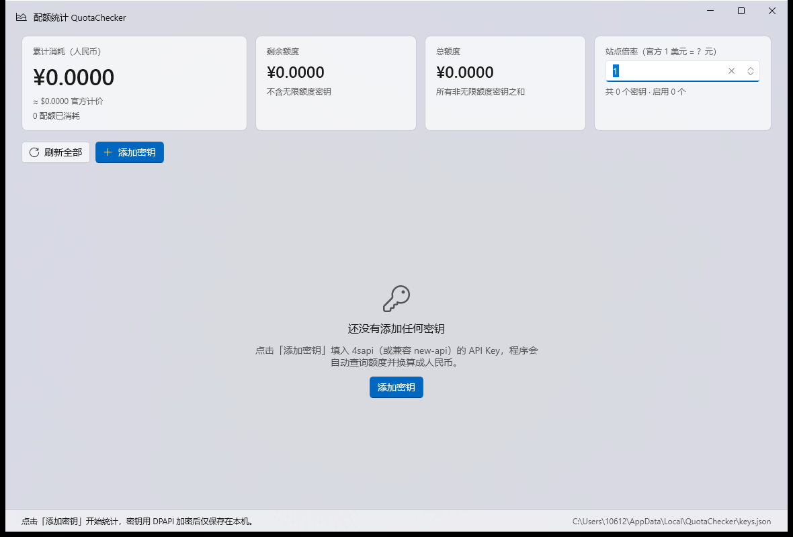

# 配额统计 QuotaChecker

WinUI 3 风格的 Windows 桌面程序：添加多个 API 密钥，自动查询每个密钥的 **quota 消耗**，换算成**人民币金额**，并汇总全部密钥的总消耗。

数据来源为中转站（4sapi / new-api 系）的 `GET /api/usage/token` 接口。



## 下载 / 直接使用

不想自行编译的话，到 [Releases](https://github.com/Yanmiao233/4SAPIQuotaChecker/releases) 下载
`QuotaChecker-portable-win-x64-v<版本>.zip`（约 31 MB），解压后双击根目录的
`启动 QuotaChecker.exe` 即可。

解压后根目录只有 3 项，程序文件都收在 `app\` 子目录里：

```
QuotaChecker-portable-win-x64\
├── 启动 QuotaChecker.exe      双击这个启动（几 KB 的原生启动器）
├── 使用说明.txt
└── app\                       程序本体
```

便携版为 **self-contained**：目标机器无需安装 .NET 运行时，也无需安装 Windows App SDK，
解压即用、删目录即卸载。

## 功能

- **添加多个密钥**：每个密钥可单独命名、指定接口地址，添加后立即自动查询
- **自动查询 quota**：启动时自动刷新全部启用的密钥，也可手动「刷新全部」或单独刷新某个密钥
- **各模型消耗**：展开密钥卡片查看每个模型的消耗金额与调用次数（由最近最多 1000 条调用日志聚合）
- **定时自动刷新**：可在「设置」里选择 1 / 5 / 15 / 30 / 60 分钟，默认关闭
- **换算人民币**：`配额 ÷ 500000 × 站点倍率`，界面同步显示配额原值、官方美元价与人民币金额
- **总计消耗金额**：顶部卡片实时汇总所有启用密钥的累计消耗、剩余额度与总额度
- **无限额度 / 过期时间**：正确识别 `unlimited_quota`，无限额度密钥不计入总额度统计
- **密钥安全**：API Key 使用 Windows DPAPI（仅当前用户可解密）加密后存于本机，界面只显示掩码
- **跟随系统主题**：浅色 / 深色自动适配，窗口使用 Mica 背景
- **崩溃日志**：未处理异常写入 `%LOCALAPPDATA%\QuotaChecker\crash.log`，便于反馈问题
- **应用内更新**：设置菜单里「检查更新」，一键下载新版本并自动重启完成升级

## 换算规则

| 项目 | 说明 |
| --- | --- |
| 配额基数 | new-api 体系中 `500000 配额 = 官方计价 1 美元` |
| 站点倍率 | 1 倍率即「1 美元官方价格扣 1 元」，2 倍率即扣 2 元，可在界面调整 |
| 人民币金额 | `配额 ÷ 500000 × 倍率` |
| 备注 | 4sapi 基础汇率固定 1 美元 = 1 人民币；若站点倍率不同（如 6 倍率）直接改界面上的倍率即可 |

示例：`1,250,000 配额` → `$2.5 官方计价` → 1 倍率下 `¥2.5000`

## 设置（二级菜单）

工具栏上的齿轮按钮打开设置弹层，里面只有两项：

| 项目 | 说明 |
| --- | --- |
| 站点倍率 | 默认 `1`。按你的分组填写，改完立即重算所有金额并保存 |
| 自动刷新间隔 | 默认「关闭」。可选 1 / 5 / 15 / 30 / 60 分钟 |

这两项都会写进 `keys.json`。倍率不再占用首屏卡片位置，
自动刷新关闭时程序只在启动、手动刷新、添加密钥时查询。

## 接口

```
GET {站点地址}/api/usage/token/
Authorization: Bearer sk-xxxxxxxx
```

响应关键字段：

```json
{
  "code": true,
  "data": {
    "name": "令牌名",
    "total_granted": 30000000,
    "total_used": 1250000,
    "total_available": 28750000,
    "unlimited_quota": false,
    "expires_at": 1798761600,
    "user_quota": { "total_available": 50000000, "total_used": 8300000 }
  }
}
```

### 各模型消耗

密钥卡片上的「各模型消耗」展开条对应：

```
GET {站点地址}/api/log/token
Authorization: Bearer sk-xxx
```

返回该密钥最近最多 1000 条调用日志（每条含 `model_name` / `quota` /
`prompt_tokens` / `completion_tokens`），程序在本地按模型聚合出消耗金额与调用次数。
只看总额的话不用展开，展开才发起这次请求。

> 官方文档另有一个 `/api/log/self/token_daily/model_full` 接口（按 token_id 查模型汇总），
> 但它要求「系统访问令牌 + 用户名」而不是 sk- 密钥，本程序没有采用。

站点地址可以只填域名（如 `https://4sapi.org`），程序会自动补全 `/api/usage/token/`。

### 尾斜杠很重要（曾经的 401 坑）

new-api 的路由实际注册为 **带尾斜杠** 的 `/api/usage/token/`：

```go
usageRoute := apiRouter.Group("/usage")
tokenUsageRoute := usageRoute.Group("/token")
tokenUsageRoute.GET("/", controller.GetTokenUsage)
```

请求不带尾斜杠时，Gin 会 301 重定向到带斜杠的地址，而 `HttpClient` 在跟随重定向时
**会把 `Authorization` 头丢掉**，服务端于是返回：

```
401 Unauthorized {"message":"Token not provided","success":false}
```

程序现在做两件事来避免这个问题：

1. 统一请求带尾斜杠的地址，从根上不触发这次重定向；
2. 关闭 `AllowAutoRedirect`，自己跟随跳转，从而在跳转后仍保留 `Authorization`
   （旧版站点如果只注册了不带斜杠的路由也能正常工作）。

出于安全考虑，只有 **同主机 + 同端口 + 不降级为明文 HTTP** 的跳转才会被跟随；
若站点跳到别的域名，程序会停止并提示把「接口地址」直接改成该域名，不会把密钥发出去。

## 构建与运行

环境要求：

- Windows 10 1809（17763）或更高版本
- [.NET 8 SDK](https://dotnet.microsoft.com/download/dotnet/8.0)（本项目在 8.0.426 上验证通过）
- **无需安装 Visual Studio**：PRI / XAML 生成所需的 MSBuild 任务由 `Microsoft.Windows.SDK.BuildTools.MSIX` 包提供

clone 并构建：

```powershell
git clone https://github.com/Yanmiao233/4SAPIQuotaChecker.git
cd 4SAPIQuotaChecker

# 默认 win-x64
dotnet build src\QuotaChecker\QuotaChecker.csproj -c Debug

# 指定平台（x64 / ARM64）
dotnet build src\QuotaChecker\QuotaChecker.csproj -c Debug -p:Platform=x64
dotnet build src\QuotaChecker\QuotaChecker.csproj -c Debug -p:Platform=ARM64
```

运行（unpackaged，双击 exe 或命令行启动）：

```powershell
.\src\QuotaChecker\bin\Debug\net8.0-windows10.0.19041.0\win-x64\QuotaChecker.exe
```

生成可分发目录（Release 会自动裁剪体积）：

```powershell
dotnet publish src\QuotaChecker\QuotaChecker.csproj -c Release -p:Platform=x64 -o publish
```

一键生成便携版压缩包（推荐，含裁剪 + 目录整理 + 压缩）：

```powershell
powershell -ExecutionPolicy Bypass -File tools\build-portable.ps1
# -Platform ARM64    出 ARM64 包
# -NoTrim            关闭裁剪（排错用，体积翻倍）
# -KeepAllLocales    保留全部语言资源
# -Version 1.2.0     覆盖版本号（默认读 csproj 的 <Version>）
```

产物在 `dist\QuotaChecker-portable-win-x64-v<版本>.zip`，压缩包名自动带上版本；
解压后的目录名保持 `QuotaChecker-portable-win-x64` 不变，方便覆盖升级。

外层启动器说明：`.lnk` 快捷方式保存的目标会被 Windows 转成本机绝对路径，
压缩包解压到别的目录后必然失效，所以外层放的是一个 **20KB 的原生启动器 exe**
（Windows 自带的 csc 编译，目标机器无需任何运行时），它按自身所在目录启动
`app\QuotaChecker.exe`，整包移动/改名/换机器都有效。

程序为 **unpackaged + self-contained**：不需要安装 MSIX，也不需要目标机器预装 .NET 运行时或 Windows App SDK。

### 体积优化说明

| 措施 | 效果 |
| --- | --- |
| `PublishTrimmed`（Release 默认开启） | 166 MB → 90 MB |
| 只保留 en/zh 语言资源（82 个语言目录） | −3.4 MB、−82 个目录 |
| 移除 Widgets / WebView2 / DiaSymReader | −6.2 MB |
| 最终压缩包 | **31.5 MB**（169 个文件） |

裁剪有两点必须注意，改动 csproj 时不要删掉：

1. **`BuiltInComInteropSupport=true`** —— WinUI / CsWinRT 依赖内置 COM 互操作，裁剪默认把它关掉，
   表现为程序启动几秒后崩溃、退出码 `0xC000027B`。
2. **`TrimmerRootAssembly`（WinRT.Runtime / Microsoft.WinUI / CommunityToolkit.Mvvm / QuotaChecker）**
   —— CsWinRT 在运行时用反射计算 COM 接口表，这些类型被裁掉后，
   给 `ListView.ItemsSource` 赋值就会抛 `NullReferenceException`（同样是 `0xC000027B`）。

`KeyStore` 的 JSON 读写使用 **源生成序列化**（`Models/AppJsonContext.cs`）而不是反射，
否则裁剪后密钥配置会静默读写失败。

publish 时仍会看到一条 `IL2026: Built-in COM support is not trim compatible` 警告——
这是开启 `BuiltInComInteropSupport` 的必然结果，WinUI 无法避免，不是本项目的问题。

## 应用内更新

设置菜单（齿轮）→「检查更新」：

1. 程序请求 GitHub Releases 最新版本并与当前版本比较（匿名 API，每 IP 每小时 60 次限额）
2. 有新版本时显示更新说明与附件大小，确认后下载（带进度）
3. 点「重启并更新」：程序退出 → 更新器替换 `app\` 目录 → 自动重启

- **密钥配置存放在 `%LOCALAPPDATA%\QuotaChecker\`，更新不影响**
- 只支持 win-x64 便携版布局（`app\` 上级目录结构）；开发构建会提示手动下载
- 更新器是更新时临时编译的几 KB 原生程序（Windows 自带 csc），全程无黑框
- 下载内置断流看门狗：超过 120 秒没有数据会报错而不是永远等待
- GitHub 匿名 API 有限额，若提示 rate limit exceeded 请稍后再试

## 数据存放位置

```
%LOCALAPPDATA%\QuotaChecker\keys.json
```

密钥以 DPAPI 密文（`ProtectedApiKey`）保存，仅同一 Windows 账号可解密；换机器或换账号后需要重新录入。
状态栏右下角会显示该路径。

## 项目结构

```
QuotaChecker.sln
packaging/                        便携版的根目录素材（启动器、说明）
├─ 启动 QuotaChecker.cmd
└─ 使用说明.txt
tools/
├─ build-portable.ps1             一键出便携版压缩包
├─ make-launcher.ps1              生成外层「启动 QuotaChecker.exe」启动器
└─ make-icon.ps1                  生成 app.ico（蓝色圆角块 + 白色 ¥）
src/QuotaChecker/
├─ app.ico                        程序图标（9 种尺寸）
├─ app.manifest                   DPI 感知与系统兼容性声明
├─ App.xaml(.cs)                  应用入口 + 崩溃日志
├─ MainWindow.xaml(.cs)           窗口外壳（Mica 背景、自定义标题栏、尺寸）
├─ Models/
│  ├─ AppModels.cs                存储模型、设置、响应解析
│  └─ AppJsonContext.cs           源生成 JSON 序列化上下文（裁剪安全）
├─ Services/
│  ├─ QuotaClient.cs              /api/usage/token 调用与地址规范化
│  └─ KeyStore.cs                 DPAPI 加密的本地存储
├─ Converters/
│  ├─ MoneyMath.cs                配额 → 美元 → 人民币 换算与格式化
│  └─ CommonConverters.cs         XAML 值转换器
├─ ViewModels/
│  ├─ MainViewModel.cs            汇总、刷新编排、持久化
│  └─ ApiKeyViewModel.cs          单个密钥的额度状态
└─ Views/
   ├─ MainPage.xaml(.cs)          主界面
   └─ AddKeyDialog.xaml(.cs)      添加密钥对话框
```

> `tools\*.ps1` 均为 **UTF-8 with BOM**（Windows PowerShell 5.1 需要 BOM 才能正确读取中文）。

## 已知限制

- `user_quota`（账号余额）仅在令牌开启「允许查询用户额度」时由服务端返回；未返回时界面只展示令牌自身的额度。
- 汇率/倍率为手动填写，程序不会联网获取实时汇率。
- 无法做成单文件 exe：Windows App SDK 的单文件发布要求 `EnableMsixTooling`，而它依赖 Visual Studio 自带的 MSIX 构建任务，本项目为了「只装 .NET SDK 就能构建」没有引入。
- 便携版启动器是 `.cmd` 而非 `.lnk`：快捷方式里存的是绝对路径，换个解压目录就失效了。
